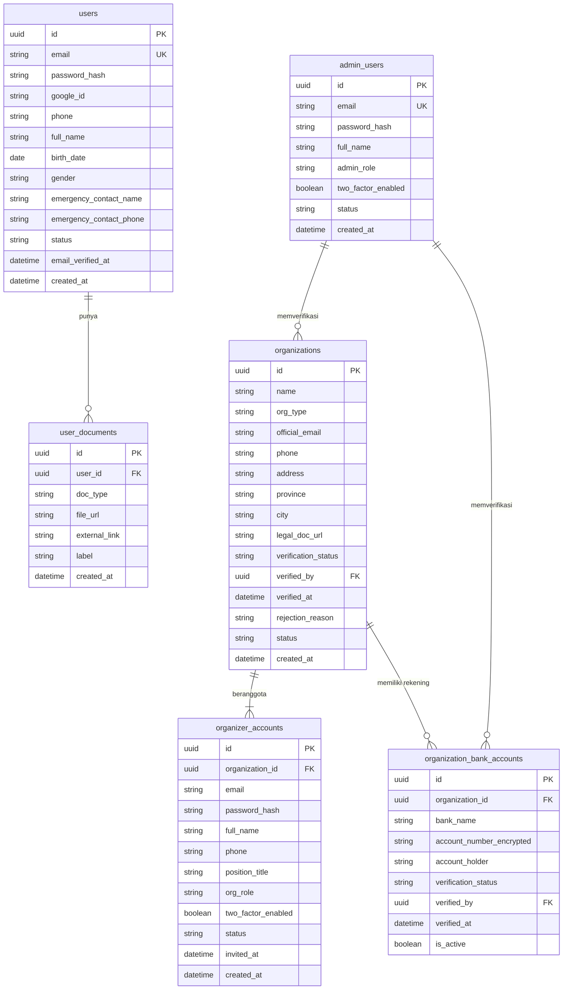
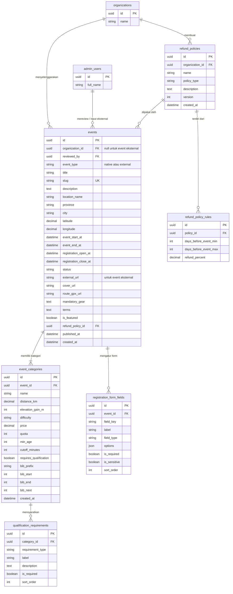
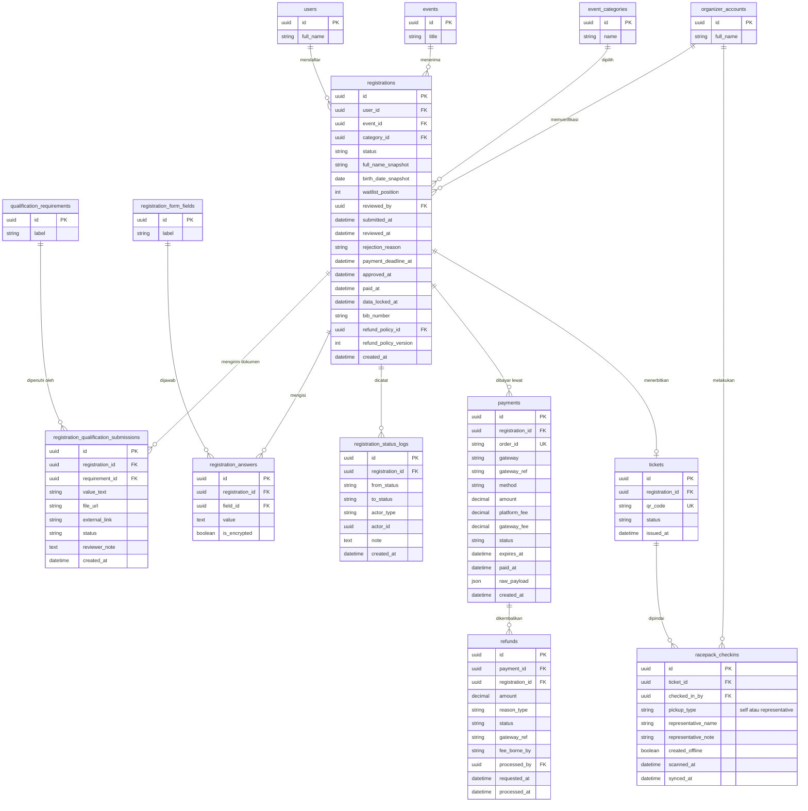
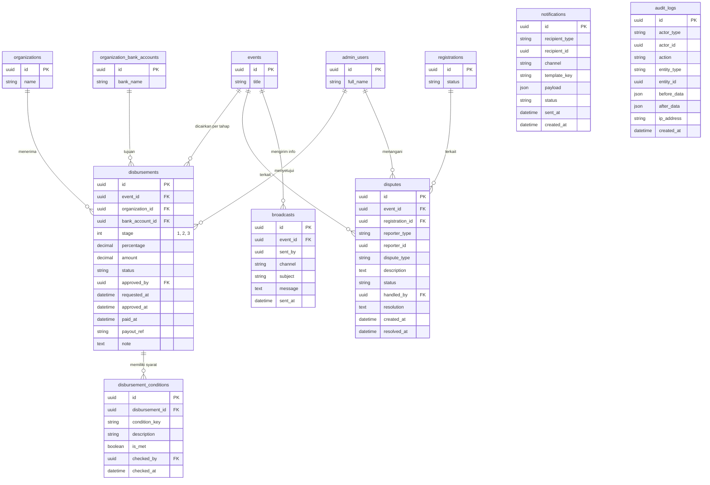
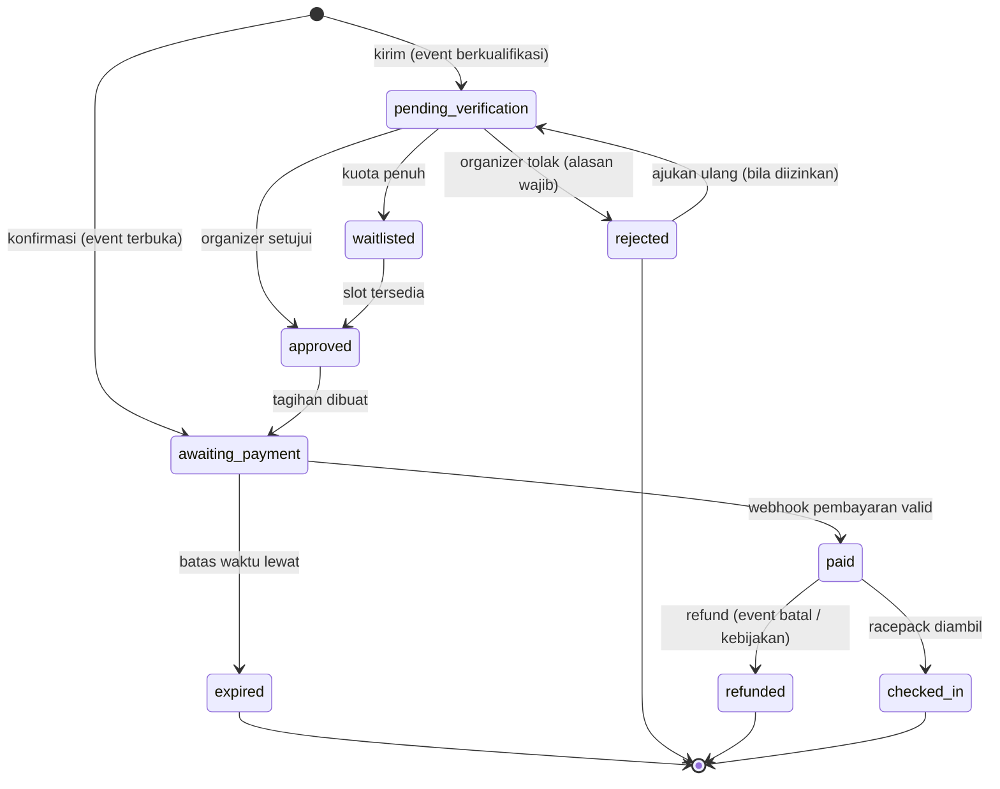
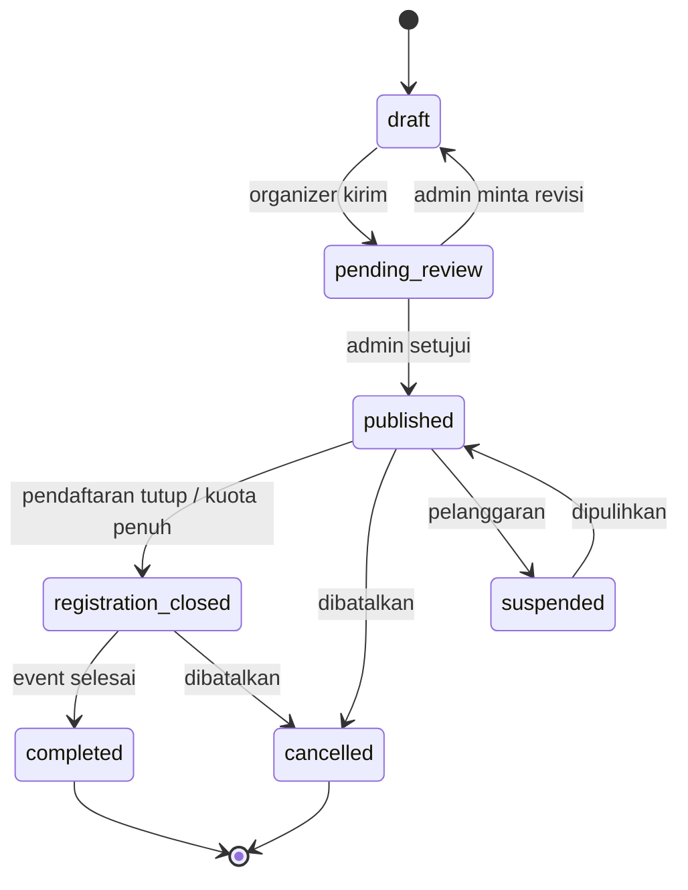
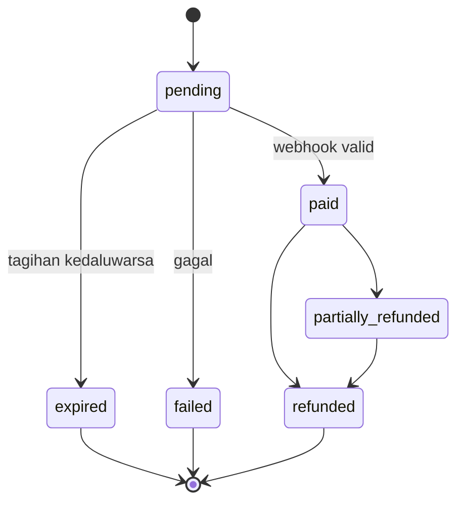

# Event Platform ERD

> Pendamping dokumen `Event-Platform-PRD.md`. Diagram memakai sintaks Mermaid (`erDiagram`), dapat dirender di GitHub, GitLab, Notion, VS Code (ekstensi Mermaid), atau mermaid.live.
> Tipe data bersifat konseptual dan disesuaikan dengan basis data yang dipilih (disarankan PostgreSQL).

---

## 1. Ringkasan Domain

| Domain | Tabel |
|---|---|
| Akun peserta | `users`, `user_documents` |
| Organisasi dan akun organizer | `organizations`, `organizer_accounts`, `organization_bank_accounts` |
| Admin platform | `admin_users` |
| Event | `events`, `event_categories`, `qualification_requirements`, `registration_form_fields`, `refund_policies`, `refund_policy_rules` |
| Pendaftaran | `registrations`, `registration_qualification_submissions`, `registration_answers`, `registration_status_logs` |
| Pembayaran | `payments`, `refunds` |
| Pasca-lunas | `tickets`, `racepack_checkins` |
| Pencairan dana | `disbursements`, `disbursement_conditions` |
| Pendukung | `disputes`, `broadcasts`, `notifications`, `audit_logs` |

---

## 2. Diagram: Akun, Organisasi, dan Admin

**Catatan**
- `users.email` unik di tabel `users`. Email boleh sama dengan `organizer_accounts.email` (registrasi terpisah, login memilih konteks).
- `organizer_accounts.org_role`: `owner`, `verifier`, `racepack_staff`, `finance`.
- `admin_users.admin_role`: `super_admin`, `support`, `finance`.
- Akun yang membuat organisasi otomatis `owner`.

---

## 3. Diagram: Event dan Kebijakan

**Catatan**
- `events.event_type`: `native` (pendaftaran di platform) atau `external` (kalender saja, `external_url` terisi, `organization_id` boleh null).
- `events.status`: `draft`, `pending_review`, `published`, `registration_closed`, `cancelled`, `completed`, `suspended`.
- `qualification_requirements.requirement_type`: `finisher_certificate`, `race_result_link`, `profile_link` (misal Strava/ITRA), `medical_certificate`, `custom_text`.
- `registration_form_fields.field_type`: `text`, `number`, `select`, `date`, `file`, dan lain-lain. `is_sensitive` menandai data medis/kontak darurat yang harus dienkripsi dan dibatasi aksesnya.
- `refund_policy_rules`: aturan bertingkat berdasarkan jarak hari ke event, misalnya >= 30 hari sebelum event: 70 persen. Jika `policy_type = no_refund`, tidak ada rule.
- `refund_policies.version`: saat kebijakan berubah, buat versi baru agar transaksi lama tetap merujuk versi yang disetujui saat bayar.
- `event_categories.bib_next`: penghitung BIB berikutnya (update atomik saat penerbitan BIB).

---

## 4. Diagram: Pendaftaran, Pembayaran, dan Pasca-Lunas

**Catatan**
- `registrations` dibatasi unik pada (`user_id`, `event_id`) untuk status aktif (satu peserta satu kategori per event).
- `full_name_snapshot` dan `birth_date_snapshot` menyimpan data saat pendaftaran supaya tidak berubah walau profil user berubah (data peserta terkunci setelah lunas).
- `registrations.refund_policy_id` + `refund_policy_version` menyimpan kebijakan yang berlaku saat peserta membayar.
- `registration_answers.is_encrypted`: true untuk kolom form sensitif.
- `registration_qualification_submissions.status`: `submitted`, `accepted`, `rejected`.
- `payments.platform_fee` dan `gateway_fee` dipisah agar rekonsiliasi dan perhitungan pencairan akurat.
- `payments.order_id` unik dan dipakai untuk idempotensi webhook.
- `refunds.reason_type`: `event_cancelled`, `participant_cancel`, `payment_error`, `overbooked`, `other`. `fee_borne_by`: `platform`, `organizer`, `participant`.
- `racepack_checkins.pickup_type`: `self`, `representative`. `created_offline` dan `synced_at` mendukung check-in offline.
- Unik pada `racepack_checkins(ticket_id)` untuk mencegah pengambilan ganda (atau gunakan status tiket `used`).

---

## 5. Diagram: Pencairan, Sengketa, dan Pendukung

**Catatan**
- `disbursements.status`: `pending`, `eligible`, `approved`, `paid`, `held`, `rejected`.
- `disbursement_conditions.condition_key` contoh: `org_verified`, `venue_permit_uploaded`, `vendor_contract_uploaded`, `racepack_ready`, `event_completed`, `no_open_dispute`.
- Validasi bisnis: jumlah pencairan kumulatif tidak boleh melebihi persentase yang diizinkan dari **dana terkumpul** (pembayaran `paid` dikurangi refund).
- `audit_logs`, `notifications`, dan `disputes` memakai `actor_type` / `reporter_type` / `recipient_type` bertipe polimorfik (`user`, `organizer`, `admin`, `system`), sehingga `actor_id` tidak memakai foreign key keras.
- `disputes.dispute_type`: `payment`, `rejection`, `event_cancelled`, `refund`, `organizer_fraud`, `other`.

---

## 6. State Machine

### 6.1 `registrations.status`

Nilai status: `pending_verification`, `approved`, `awaiting_payment`, `paid`, `rejected`, `expired`, `waitlisted`, `cancelled`, `refunded`, `checked_in`.

### 6.2 `events.status`

### 6.3 `payments.status`

---

## 7. Daftar Constraint dan Indeks Penting

| Tabel | Constraint / Indeks | Tujuan |
|---|---|---|
| `users` | UNIQUE(`email`) | Satu akun peserta per email |
| `organizer_accounts` | UNIQUE(`organization_id`, `email`) | Tidak ada anggota ganda |
| `events` | UNIQUE(`slug`); INDEX(`status`, `event_start_at`); INDEX(`province`, `city`) | Discovery dan filter |
| `event_categories` | INDEX(`event_id`); CHECK(`quota` >= 0) | Kuota valid |
| `registrations` | UNIQUE(`user_id`, `event_id`) untuk status aktif; INDEX(`event_id`, `category_id`, `status`) | Satu kategori per peserta; hitung kuota cepat |
| `registrations` | INDEX(`payment_deadline_at`) | Job kedaluwarsa otomatis |
| `registrations` | UNIQUE(`category_id`, `bib_number`) | BIB tidak ganda |
| `payments` | UNIQUE(`order_id`); UNIQUE(`gateway`, `gateway_ref`) | Idempotensi webhook |
| `tickets` | UNIQUE(`qr_code`); UNIQUE(`registration_id`) | Satu tiket per pendaftaran |
| `racepack_checkins` | UNIQUE(`ticket_id`) | Mencegah pengambilan ganda |
| `disbursements` | UNIQUE(`event_id`, `stage`) | Satu pencairan per tahap per event |
| `audit_logs` | INDEX(`entity_type`, `entity_id`); INDEX(`created_at`) | Penelusuran audit |

**Konsistensi kuota.** Hitungan slot terisi = jumlah `registrations` pada kategori dengan status `approved`, `awaiting_payment`, `paid`, `checked_in`. Pembuatan slot (transisi ke `approved`/`awaiting_payment`) harus dilakukan dalam transaksi dengan penguncian baris (`SELECT ... FOR UPDATE` pada kategori) agar tidak terjadi overselling saat trafik tinggi.

---

## 8. Pemetaan Singkat PRD ke Tabel

| Bagian PRD | Tabel utama |
|---|---|
| Auth dan peran (05, 16) | `users`, `organizer_accounts`, `admin_users`, `organizations` |
| Event dan discovery (08, 10.2-10.3) | `events`, `event_categories`, `qualification_requirements`, `registration_form_fields` |
| Pendaftaran dan verifikasi (06, 09, 10.4) | `registrations`, `registration_qualification_submissions`, `registration_answers`, `registration_status_logs` |
| Pembayaran dan refund (15) | `payments`, `refunds`, `refund_policies`, `refund_policy_rules` |
| BIB, tiket, racepack (10.6) | `registrations.bib_number`, `event_categories.bib_*`, `tickets`, `racepack_checkins` |
| Pencairan bertahap (15.4) | `disbursements`, `disbursement_conditions`, `organization_bank_accounts` |
| Sengketa dan komunikasi (12, 10.7) | `disputes`, `broadcasts`, `notifications` |
| Log audit (16, AR-08) | `audit_logs` |

---

## 9. Tabel Pasca-MVP (belum digambar)

- `wishlists` (`user_id`, `event_id`), `runner_profiles`, `race_history`, `badges`
- `addons`, `registration_addons` (penginapan, transport, jersey ekstra)
- `referral_links`, `referral_conversions` (komisi referral)
- `featured_placements` (promosi berbayar)
- `organization_members` terpisah dari `organizer_accounts` bila satu akun perlu tergabung di banyak organisasi
